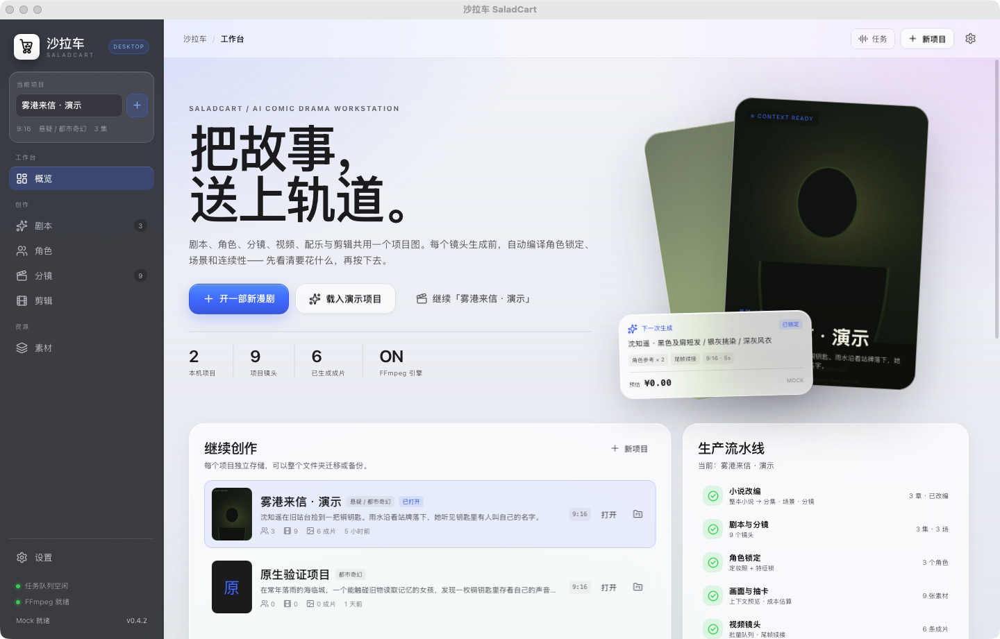

# 沙拉车 SaladCart

> 一台为 AI 漫剧和 AI 短剧创作者打造的原生桌面工作站。剧本、角色、分镜、视频、配乐与剪辑在同一个项目里自动流转。

SaladCart 使用 **Tauri 2 + Rust + React** 构建，原生支持 macOS 与 Windows。每个项目拥有独立的 SQLite 数据库、素材目录与成片目录。项目内的剧本、角色、风格圣经、分镜、配乐与生成任务互相引用；生成视频时自动组装上下文，先预览再付费。

0.4.0 起界面采用参考 macOS 26 / iOS 26 的 Liquid Glass 视觉体系：深色玻璃侧栏、磨砂面板、系统蓝主交互色与 SF Pro 字体；0.4.2 将图标收敛为 Qoder 风格的白色底、单色线稿购物车与三颗沙拉球。规范见 [docs/design/ui-liquid-glass.md](docs/design/ui-liquid-glass.md)。



## 为什么是它

浏览器生成器只解决“生成一次”，SaladCart 解决一部漫剧的循环：

1. **从小说或立意到分镜**：粘贴/导入完整小说，按章切分、分块理解并跨章合并角色，自动产出故事圣经、分集、场景和镜头；也可以从一句立意直接生成。
2. **角色锁定**：角色圣经 + 定妆照/三视图 + 硬性特征锁，生成每个镜头时自动注入。
3. **上下文可见**：发送前看到最终提示词、角色参考、连续性、画幅与成本。上下文编译器是产品核心。
4. **批量抽卡与选片**：持久化任务队列、并发上限、失败重试；镜头历史 take 可切换，切换后自动回到待审；每次 take 保留版本、seed、模型与父资产。
5. **配乐与卡点**：搜索正版曲库或 AI 生成配乐；Rust 原生节拍分析；切点自动吸附到节拍。
6. **粗剪与交付**：自动按剧本装配（可选仅已通过镜头）、字幕、配乐、原片声轨（可逐段静音）、系统配音，9:16 / 16:9 / 1:1 / 4:5，FFmpeg 导出 MP4。
7. **项目隔离与复用**：每个项目独立存储；本机图片/视频/音频可导入素材库并自动探测时长与封面；从其他项目导入角色与风格会复制素材，不建立实时依赖。
8. **成本护栏**：项目级预算上限，按排队/运行中的估算加已完成实付计费，超额任务在入队时直接拦截。
9. **热点参考**：读取授权的抖音热榜接口，由当前编剧模型给出项目专属的钩子、结构和风险建议；不抓取网页、不照搬原视频，见 [docs/trend-reference.md](docs/trend-reference.md)。

## 快速开始

前置：Node.js ≥ 20.19、pnpm、Rust stable。开发构建会由 `prepare:ffmpeg` 下载平台对应的 FFmpeg 并作为 sidecar 打进原生应用；源码运行时也可以使用本机 FFmpeg。

```bash
pnpm install
pnpm dev            # 浏览器演示桥接（无需 Key，含完整演示项目）
pnpm dev:tauri      # 原生桌面开发模式
pnpm test           # 前端测试
pnpm test:rust      # Rust 测试
pnpm check:windows  # Windows 目标编译门禁（cargo-xwin）
# 打包后的二进制可跑无界面自检：saladcart --selftest
pnpm build:tauri    # 打包当前平台
pnpm seed:demo      # 向本机工作区注入一部完整演示项目（剧本/角色/视频/配乐）
```

打包产物自带 FFmpeg sidecar；若你想在开发模式使用自己的引擎，可在设置中指定路径，或设置 `SALADCART_FFMPEG`。未找到 FFmpeg 时剧本与图片生成仍可用，视频与导出会给出可操作的错误。FFmpeg 的许可证与来源见 [THIRD_PARTY_NOTICES.md](THIRD_PARTY_NOTICES.md)。

## 已接入的供应商

| 能力 | 适配器 |
| --- | --- |
| 编剧 / LLM | Mock、任意 OpenAI 兼容接口（OpenAI、DeepSeek、Qwen/DashScope、Ollama） |
| 文生图 / 角色参考 | Mock、OpenAI Images、Gemini / Imagen、Replicate、ComfyUI、Stability、fal.ai、火山方舟 Seedream |
| 视频 | Mock（本地 FFmpeg）、Kling、Runway、Luma、MiniMax、Veo、Replicate、fal.ai、火山方舟 Seedance |
| 音乐 | Mock（本地合成 100 BPM）、Stability Audio、ElevenLabs Music、火山引擎 GenBGM；Jamendo 正版曲库搜索 |

密钥只存在 macOS Keychain / Windows Credential Manager，不进入项目、日志或渲染层。详细配置与已知接口差异见 [docs/provider-setup.md](docs/provider-setup.md)。

**没有 Key 也能完整跑通**：Mock 编剧会生成中文分镜，Mock 画师生成品牌化占位画面，Mock 视频通过 FFmpeg 生成本地片段，Mock 配乐合成可卡点的 100 BPM 音轨。浏览器演示模式会自动加载「雾港来信」；原生端可在概览点「载入演示项目」，或用 `pnpm seed:demo` 注入完整示例。

## 项目数据

```
macOS:   ~/Library/Application Support/com.saladcart.studio
Windows: %APPDATA%\com.saladcart.studio
  settings.json
  projects/<uuid>/
    project.db
    project.json
    assets/{images,videos,audio}
    thumbs/
    exports/
  trash/
```

项目可整体迁移。删除项目时移入 `trash/`，不直接永久删除。

## 验证

当前 v0.4.10 的自动化验证：

- Rust（36 项自动 + 3 项手动/外部依赖测试）：项目隔离、任务读写、Mock 剧本生成、剧本落库、角色绑定、跨项目风格复制、素材导入与媒体元数据、跨项目角色原子导入、上下文编译器、关键帧作为视频首帧、镜头历史 take 与审片装配、项目预算护栏、长篇小说切章/分块改编、小说 LLM 分块契约、OpenAI Images / Kling / 火山方舟 Seedream / Seedance / GenBGM 契约测试、完整演示项目、时间线自动装配、节拍吸附、节拍检测、Mock WAV、真实 FFmpeg 音视频混合渲染、原片静音混音、Windows 文件名清洗、溯源清单、系统配音、DeepSeek 实时剧本生成。
- 前端（10 项）：时间码/时长工具、浏览器演示桥接、上下文编译、Jamendo 曲库搜索、节拍分析/卡点、真实模型默认路由。
- 真实供应商：DeepSeek 剧本与小说改编、Seedream 5.0 Flash 关键帧/角色定妆照、Seedance 1.0 Pro Fast 图生视频均实际出片；真实视频已写入镜头 take、自动装配并导出 1080×1920 MP4；macOS 系统 TTS 生成了 1.56s 配音素材。
- 发布自检：macOS 打包 `.app` 执行 `saladcart --selftest` 成功（4 片段、19 秒 MP4、423,595 字节）；Windows 便携包同样带自检。
- 手动：Chromium 走查 Dashboard、剧本、角色、分镜、剪辑、音乐、设置；原生 `.app` 走查演示项目、3 章小说改编为 3 集 9 镜、历史 take 切换、审片装配、素材导入对话框、项目预算、批量生成 6 条系统配音、V1 配音轨，并实际导出 19 秒 1080×1920 H.264/AAC 成片。
- 跨平台：GitHub Actions 矩阵包含 macOS arm64 / x64 与 Windows x64 构建，测试使用随包 FFmpeg sidecar；Windows 目标已通过 `cargo xwin check` 编译检查，但未在 Windows 真机运行；未配置 Apple/Windows 签名证书，因此产物为未签名版本。

```bash
pnpm test
SALADCART_FFMPEG=$(command -v ffmpeg) cargo test --manifest-path src-tauri/Cargo.toml
```

## 发布状态

`v0.4.10` 的源码已提交到仓库。macOS arm64 未签名、自带 FFmpeg 的 DMG 在 `release/SaladCart_0.4.10_aarch64.dmg`（SHA-256 `39e0f50818c33a7f30d902db2c93d5d461aab76a65ad34b7b122c6f3ee83d111`）。按项目要求跳过 Windows 打包，未发布 0.4.10 Windows 产物。校验值、安装提示与已知边界见 [docs/release-0.4.10.md](docs/release-0.4.10.md)，发布门禁见 [docs/release-checklist.md](docs/release-checklist.md)。本机未安装/登录 `gh`，未创建公开 GitHub Release。

## 产品研究

AI 漫剧的真实生产痛点、证据来源与逐项对策见 [docs/pain-points.md](docs/pain-points.md)。架构与阶段决策见 [docs/architecture.md](docs/architecture.md)。

## 已知边界（v0.4）

- 每个项目当前保留一部小说源；一次改编最多 120 个分析块（约 72 万字），更长的小说需分卷。
- 尚未集成评论、角色权限、共享审片与备案清单导出；审片状态是单机数据，不构成多用户审批记录。
- 视频供应商当前只接收一张首帧图，多参考图输入尚未发送。
- 自动卡点使用轻量 Rust DSP，不含 downbeat ML；可后续接入 Beat This 做可选高精度分析。
- Kling / Luma / MiniMax / Veo 等视频 API 的路径、模型名与账号区域会变化；适配器保留 provider options 覆盖与原始错误，不做假成功。
- 未包含口型同步、声音克隆与多轨 NLE；v0.3 聚焦从长篇小说到可交付粗剪的闭环。
- 发布产物未签名/未公证，生产分发前需配置 Apple Developer 与 Windows 代码签名证书。

## License

Source code © SaladCart. Third-party provider terms and music licences apply separately.
